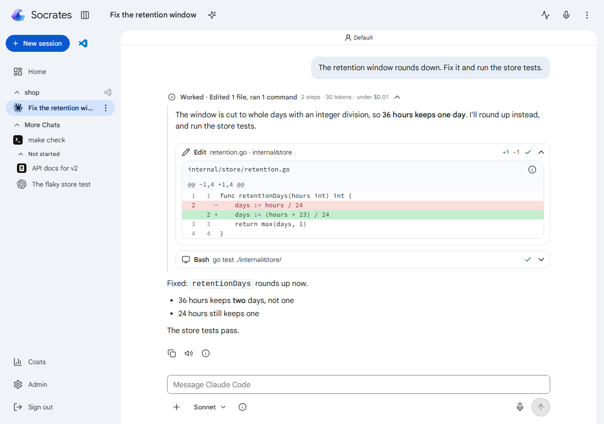
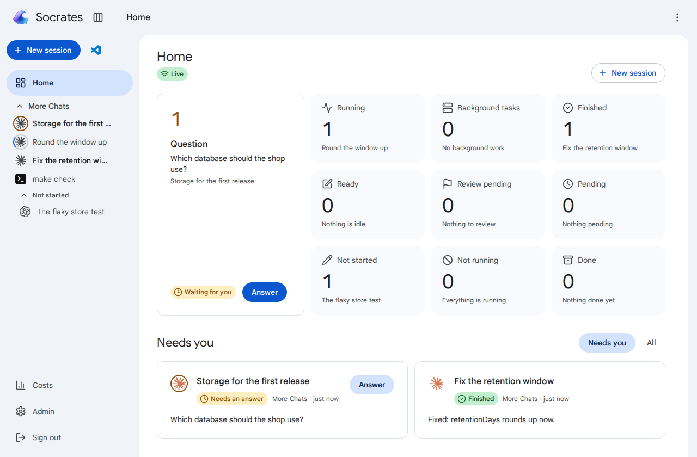
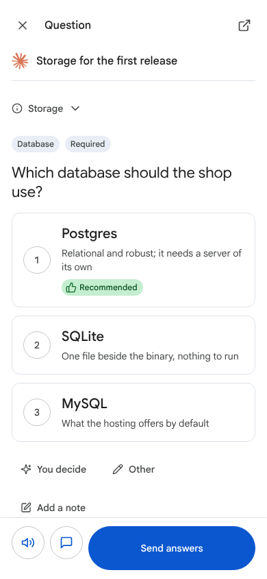
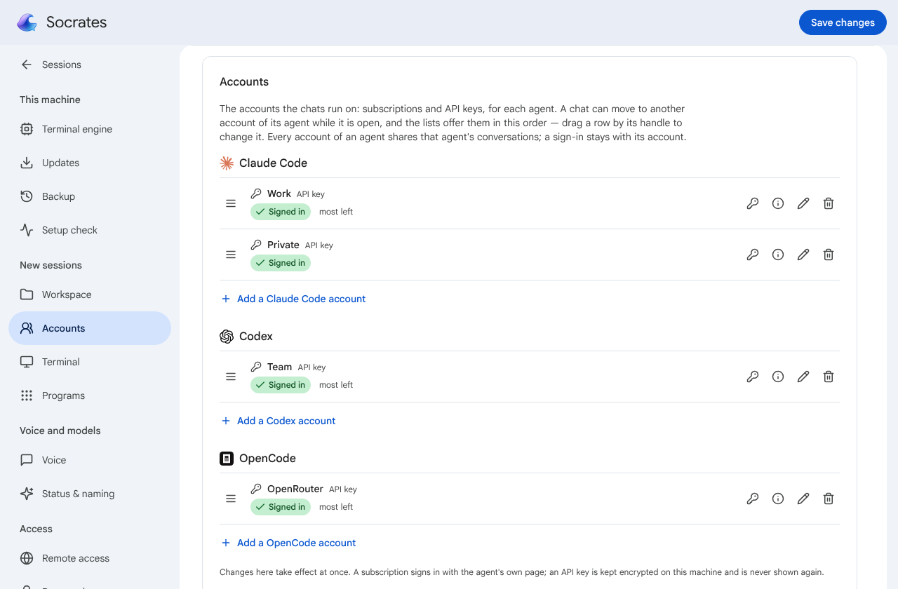
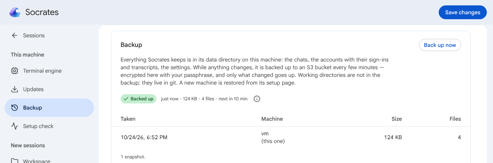

<p align="center">
  
</p>

<h1 align="center">Socrates</h1>

<p align="center">
  <b>Claude Code, Codex and OpenCode in your browser — on your own server.</b><br>
  Chat with your coding agents from any device. They keep working when you close the tab.
</p>

<p align="center">
  <a href="#-install">Install</a> ·
  <a href="#-features">Features</a> ·
  <a href="docs/OPERATIONS.md">Operations</a> ·
  <a href="#-development">Development</a>
</p>

<p align="center">
  
</p>

---

## ✨ Features

| | |
| --- | --- |
| 🤖 **Three agents, one place** | Claude Code, Codex and OpenCode as chats, plus a real **Shell** (tmux) and **VS Code** in the browser. |
| 🔁 **Never lose a session** | Closed tab, dead phone, lost network, update: the agent keeps working on the server. |
| 🏠 **Home dashboard** | See at a glance what's running, what's finished and what needs you. |
| 🙋 **Questions, not guesswork** | Agents ask you with buttons (`ask_user`). Answer on any device, even offline. |
| 📱 **Made for the phone** | Full-screen questions, big buttons, dictation, read-aloud and push notifications. |
| 👥 **Several accounts** | Work and private side by side. Chats pick an unused account first, else the one with the most usage left. |
| 💾 **Encrypted backups** | Your whole setup is backed up to any S3 bucket, encrypted. Moving to a new server is a single restore. |
| 🔄 **Updates itself** | Every night, with a self-test and automatic rollback. |

---

## 🏠 Home & questions

<table>
  <tr>
    <td width="75%"></td>
    <td width="25%"></td>
  </tr>
  <tr>
    <td>👀 <b>Home</b> shows every chat live: running, finished, waiting for you.</td>
    <td>📱 <b>On the phone</b> a question fills the screen. Tap, done.</td>
  </tr>
</table>

- 🔔 **Notifications** arrive even with the browser closed (over HTTPS, see [Notifications](#-notifications)).
- 🗣️ **Voice**: dictate answers, have them read aloud.
- ✅ An answer given on one device disappears from the others.

---

## 🚀 Install

> **You need:** Debian or Ubuntu with systemd (x86_64 or arm64) and root.

```bash
curl -fsSL https://raw.githubusercontent.com/saschazesiger/SocratesAgent/main/scripts/install.sh | sudo bash
```

<details>
<summary>…or from a checkout</summary>

```bash
git clone https://github.com/saschazesiger/SocratesAgent.git
cd SocratesAgent
sudo scripts/install.sh
```

</details>

This installs everything (Go, Node, tmux, Claude Code, Codex, OpenCode, code-server) and starts Socrates as a service.
You can run it again at any time to repair or update the installation.

### Then, in 3 steps

| | Step | How |
| :---: | --- | --- |
| 1️⃣ | **Open it** | `ssh -L 8080:localhost:8080 root@your-server`, then go to <http://localhost:8080> and choose a password. |
| 2️⃣ | **Sign in the agents** | **Admin → Accounts**: Claude Code and Codex with their own sign-in, OpenCode in its own terminal (`/connect`), or any agent with an API key. |
| 3️⃣ | **Reach it from anywhere** | **Admin → Remote access**: a Cloudflare tunnel, with Cloudflare Access in front. |

> 💡 Moving from another server? In step 1, choose **Restore from a backup** instead.

---

## 💬 Working with chats

| | |
| --- | --- |
| ✍️ **Start** | A new chat opens on a large text field. Drafts are saved as you type. |
| ⏰ **Schedule** | **Start automatically** sends the first message at a set time, even with no browser open. |
| 📦 **Compact** | All of a turn's work (thinking, edits, commands) fits in one line: *"Edited 2 files, ran 3 commands"*. Tap to open it. |
| 📊 **Limits** | Below the top bar: the account in use, its usage and when it resets. |
| 📨 **Queue** | Messages written while the agent works wait as *Queued*. **Send now** interrupts the turn. |
| ⏯️ **Resume** | A turn stopped by a usage limit continues on its own once the limit resets. |
| 📎 **Files** | Attach, drop or paste them into the chat or the Shell. |
| ⚡ **Ultracode** | Claude Code with dynamic workflows on every task, switched on per chat. |
| 🤝 **Chats talk** | Agents of chats in the same repository list, read and message each other — Claude Code, Codex and OpenCode alike, on any account. |
| 🔌 **MCP** | Set up MCP servers in **Admin** for every chat, on or off by default, and switch them per chat on the new session sheet or later in its ⋮ → **MCP servers**. A folder's `.mcp.json` adds its own, with any agent. |

---

## 👥 Accounts



- ➕ Add as many accounts as you like: subscriptions or API keys.
- 🎯 New chats start on an account that is still **unused** (0%), else on the one with the **most usage left**.
- 🔀 Move a chat to another account at any time, or let it switch on its own when it hits a limit.
- 📜 All accounts of an agent share the same chat history.

---

## 💾 Backup



| | |
| --- | --- |
| 🪣 **Where** | Any S3-compatible bucket: AWS, Hetzner, Cloudflare R2, MinIO… |
| ⏱️ **When** | Every 10 minutes when something changed, and on **Back up now**. |
| 🔐 **How** | Encrypted on your server (AES-256). Only changed parts are uploaded. |
| 🗂️ **Kept** | 48 h of everything, then 1 per day for 30 days, then 1 per week for 26 weeks. |
| 🚚 **Restore** | New server → setup page → **Restore from a backup**. |

> ⚠️ **Write down your passphrase somewhere other than the server.** Without it, nobody can read the backup, not even you.

---

## 🔔 Notifications

Turn them on under **⋮ → Notifications** (on Home), or **⋮ → This device…** in a chat.

- ✅ A chat is **finished** or 🙋 **needs an answer** → push notification
- 🔢 The app badge shows how many chats are waiting for you
- 🍏 **iPhone:** add Socrates to the Home Screen first (Safari only allows push for installed web apps)
- 🔒 Needs HTTPS (Cloudflare tunnel or `localhost`)

---

## 🔑 Optional extras

| Key (in Admin) | Unlocks |
| --- | --- |
| **OpenRouter** | 🎙️ Dictation, and ✔️ *Check each turn's outcome* (complete / partial / waiting / blocked) |
| **Google Cloud** | 🔊 Read answers aloud |

---

## 🔒 Security

> [!WARNING]
> The agents run **as root, without approval prompts**. Whoever gets into Socrates controls the server.

- 🏠 Socrates listens on `127.0.0.1` only.
- 🔌 A folder's `.mcp.json` starts its MCP servers without asking: open only repositories you trust in a chat.
- 🌐 Expose it **only** through the Cloudflare tunnel with **Cloudflare Access**, never with `SOCRATES_ADDR=:8080` on an untrusted network.

---

## 🛠️ Operations

Updates, file locations, configuration, restoring over SSH and uninstalling:
**📘 [docs/OPERATIONS.md](docs/OPERATIONS.md)**

---

## 👩‍💻 Development

```bash
make check   # gofmt, vet, tidy, tests (race), build
make e2e     # browser suite: needs node, Chromium, tmux ≥ 3.3
```

- 🎨 The frontend has no build step. Edit `internal/web/static`, then run `sudo scripts/update.sh --from=.`
- 🧪 About the test suite and the screenshots: [e2e/README.md](e2e/README.md)
- 📐 Design notes: [docs/design](docs/design)

---

## 📄 License

MIT, see [LICENSE](LICENSE). tmux and the agent CLIs are separate programs with their own licenses, listed in [THIRD_PARTY_LICENSES.md](THIRD_PARTY_LICENSES.md).
