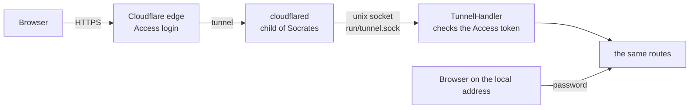

# Remote access through Cloudflare

Socrates reaches the internet through a Cloudflare Tunnel that it sets up itself with an API token, and Cloudflare
Access is the login for everybody who comes through it. This replaced the quick tunnel (`*.trycloudflare.com`) and the
named tunnel driven by a connector token pasted by hand; nothing of either is left, and a server that used them sets
the tunnel up again. The design follows CI-Plane's (`internal/cloudflare` there).

Without Cloudflare, Socrates works as before: the local address (`SOCRATES_ADDR`, `127.0.0.1:8080` by default) with
the password. That is also how a test instance runs.

## Pieces

| Piece | Where | What it does |
| --- | --- | --- |
| `internal/cloudflare` | `cloudflare.go` | state, sealed secrets, `Status`, `Check` (token → domains and, with *User Details: Read*, the token's user) |
| | `setup.go` | `Setup` / `StartSetup` (background job with steps), conflicts and *Replace*, `SetEmails`, `Remove` / `StartRemove` |
| | `supervisor.go` | `Run`: starts `cloudflared tunnel --no-autoupdate --metrics <loopback> run` with `TUNNEL_TOKEN` in the environment, polls `/ready`, restarts with backoff, checks from outside every 10 minutes, points the routing at a moved socket |
| | `jwt.go` | `Authenticate`: the `Cf-Access-Jwt-Assertion` header, RS256 only, the team's keys (cached, refetched at most every 30 s), issuer, audience, expiry, allowed address |
| | `verify.go` | the check from outside: `/` must redirect to the Access login, `/artifact-kit/` must reach Socrates (`X-Socrates-Tunnel`) |
| | `install.go` | downloads `cloudflared` into `<data>/bin` when it is not on the `PATH` (`SOCRATES_CLOUDFLARED` names another binary) |
| `internal/server/cloudflare.go` | | the socket listener, `TunnelHandler`, the `/api/cloudflare` endpoints |
| `internal/web/static/js/cloudflare.js` | | the flow in Admin → Remote access and the setup page's second step |

## The tunnel's own way in

cloudflared does not reach the local address. Socrates listens on a Unix socket, `<data>/run/tunnel.sock` (mode 0600,
not backed up), and the tunnel's routing is `unix:<that path>`. So:

- a request on the local address is never taken for one from the tunnel, whatever headers it carries;
- a request on the socket came through Cloudflare, so `Cf-Connecting-Ip` is the caller (rate limits, logs);
- two Socrates on one machine never fight over a port.

`TunnelHandler` lets the sandboxed pages through (`/docs/`, `/artifact-kit/`, `cloudflare.BypassPaths`), which guard
their files with tokens of their own, and asks every other request for a valid Access token. The token signs the
person in: `authenticated()` is true and `/api/state` says `via: "tunnel"` and the e-mail address. No Socrates cookie
is made and no password asked. Signing out answers `next: "/cdn-cgi/access/logout"`, which ends the Access session.

## What the setup creates

For `socrates.example.com`:

| Object | Name | Details |
| --- | --- | --- |
| Tunnel | `socrates-socrates.example.com` | remotely managed; routing `socrates.example.com → unix:<data>/run/tunnel.sock`, everything else 404 |
| DNS record | `socrates.example.com` | proxied CNAME to `<tunnel id>.cfargotunnel.com`, comment *Managed by Socrates (Cloudflare Tunnel)* |
| Access application | `Socrates socrates.example.com` | policy *allowed e-mails*, sessions of 30 days (`720h`), in the App Launcher |
| Access application | `Socrates socrates.example.com sandboxed pages` | `/docs` and `/artifact-kit`, policy *sandboxed pages for everyone* (Bypass) |
| Access policies | `Socrates socrates.example.com: allowed e-mails`, `…: sandboxed pages for everyone` | reusable policies |
| Login method | One-time PIN | added once if the account has none |

Every step finds what an earlier run made (stored IDs first, then by name), and the IDs are stored as soon as an object
exists, so a setup that stopped half way is finished by the next one and *Repair* is the same setup again. The tests
fail every API call of a setup once, before and after Cloudflare carried it out, and check that the next run ends with
exactly one of everything (`TestSetupResume`).

### Conflicts

Before anything is created, the setup looks at the address: a DNS record that is not Socrates' own, or an Access
application on the same address with another name, stops it with `job.conflicts` (a record that points at another
tunnel names that tunnel). The interface shows them and offers **Replace**, which runs the setup again with
`replace: true`: the record and the application are deleted, the other tunnel itself is left alone.

## State and secrets

`kv` rows: `cloudflare:state` (IDs, hostname, addresses, team domain, AUD, the routing it was set up with) and the API
token and tunnel token, sealed with the data directory's key (`cloudflare:api_token`, `cloudflare:tunnel_token`).
Neither token ever reaches the browser, an argument list or the log (cloudflared's output is redacted). The API token
is needed again only to change the addresses, to repair and to remove.

A restored or moved data directory has its socket elsewhere: at its start, `Run` points the tunnel's routing at the new
path with the stored token (`followOrigin`).

## Who may sign in

The addresses entered in the setup; Admin changes them (`PUT /api/cloudflare/emails`). Through the tunnel the server
refuses a list without the caller's own address, so nobody locks themselves out from outside.

## API

| Endpoint | |
| --- | --- |
| `GET /api/cloudflare` | `{status, token_url, permissions, via, email}`; `status.job` is the running or last setup or removal |
| `POST /api/cloudflare/check` | `{api_token}` (empty: the stored one) → `{zones, user, stored}` |
| `POST /api/cloudflare/setup` | `{api_token, zone_id, hostname, emails, replace}`, runs in the background |
| `PUT /api/cloudflare/emails` | `{emails}` |
| `POST /api/cloudflare/remove` | runs in the background; deletes apps, policies, record and tunnel, then forgets them |
